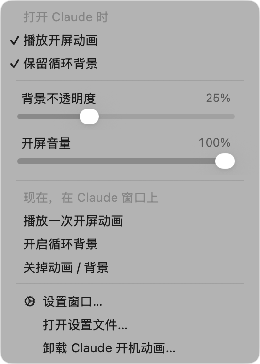
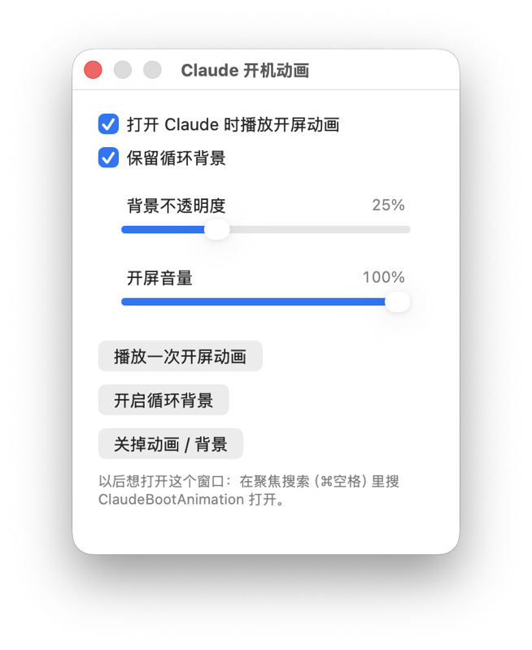

# AI Boot Animations · AI 应用开机动画

给 Mac 和 Windows 上的 AI 桌面应用加开机动画：打开应用时先放一段开屏，再透出真正的界面，留下一层半透明的动态背景。每个动画都是独立的小程序，**不修改应用本体**，随时一键卸载。

| 应用 | 动画 | 安装 |
|---|---|---|
| **Claude** 桌面端 | 月下持剑少女：线稿 → 上色 → 剑光、火凤、烟花，带音效和英文字幕；菜单栏 ✨ 可调背景浓度、开屏音量，可只留动态背景 | [claude/](claude/) |
| **ChatGPT** 桌面端（含 Codex） | 星空塔罗龙娘：发光线稿 → 展翅、七张牌亮起 → 光带环绕 → 光汇入手心 → 甩牌挡嘴，带音效、英文配音和字幕；菜单栏 🌙 可调，和 Claude 版可以同时装；Mac 和 Windows 都有 | [codex/](codex/) |

更多动画陆续加入。


## 构建与安装

环境：Python 3.11+、FFmpeg；macOS 需要 Xcode 命令行工具，Windows 使用系统 .NET Framework 编译器。

```sh
python scripts/check.py
python scripts/build.py all
```

macOS 使用 `python3`。构建不会安装程序；安装方式见 [Claude](claude/README.md#安装) / [GPT](codex/README.md#安装)。
下载脚本使用指定的可信 ZIP 地址，不绑定个人仓库。旧版请先用旧版自带的卸载功能卸载。

开发、打包、版本与 CI 说明见 [文档索引](docs/README.md)。两平台 CI 覆盖 main，普通提交不发布安装包。

## 菜单栏 ✨ 能干什么

装好后菜单栏（Windows 是右下角托盘）常驻一个小星星 ✨，点开就能调，**拖动时立刻生效**：

- **打开 Claude 时**：要不要播开屏动画、要不要留循环背景（两个都关 = 原装 Claude）
- **背景不透明度**：循环背景盖得多浓，0% 到 60%
- **开屏音量**：跟随系统音量再按比例调，系统静音时自动没声
- **现在，在 Claude 窗口上**：马上播一次开屏 / 开启循环背景 / 关掉
- **设置窗口、设置文件、卸载**

<p align="center">
  
  &nbsp;&nbsp;
  
</p>

详细说明、设置文件参数和卸载见 [claude/README.md](claude/README.md)。

## 授权

- 代码：[GPL-3.0](LICENSE)：可以自由使用和修改，发布改版时须同样开源并保留署名
- 动画素材：各文件夹 `assets/LICENSE.md` 单独说明（Claude 动画为 CC BY-NC-ND 4.0：可安装分享，不可商用、不可改后再发布）

> 非官方同人项目，与各 AI 应用的开发公司无关。Claude 是 Anthropic 的商标。

---

**English:** Boot animations for AI desktop apps on macOS and Windows. Each one is a small menu-bar helper that overlays the app's window with an intro, then fades into a translucent, click-through looping background, without modifying the app itself. See the component READMEs for local installation steps.

## 项目历史

本项目基于既有源码与素材整理，并补充原生构建基建。Git 历史按维护者要求重建为 2026 年 10 月的分组时间线，不代表实际开发或首次公开日期；验收记录见 [docs/VERIFICATION.md](docs/VERIFICATION.md)。
